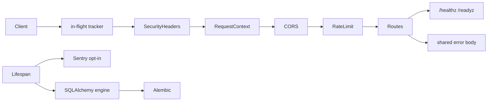

# fastapi-prod-checklist

A FastAPI template where production readiness is enforced by tests, not by a README promise.

**Demo:** [interactive checklist](https://mohamedtaqysalmi.github.io/fastapi-prod-checklist/)

## Quickstart

```bash
cp .env.example .env
python -m venv .venv
source .venv/bin/activate   # Windows PowerShell: .venv\Scripts\Activate.ps1
pip install -e ".[dev]"
uvicorn app.main:create_app --factory --no-access-log
```

Or with Docker:

```bash
docker compose up --build
```

`APP_ENVIRONMENT` is required and has no default. See `.env.example` for the full list.

## What the tests enforce

`tests/test_production_readiness.py` has one test per requirement. Each test checks
behaviour through HTTP, settings, files or a real Alembic run, so removing the feature
makes the test fail.

| Requirement | Enforcing test | Why it matters |
| --- | --- | --- |
| Liveness endpoint `/healthz` that does not touch dependencies | `test_health_endpoint_reports_liveness`, `test_health_endpoint_does_not_depend_on_readiness_checks` | Orchestrators need a cheap probe; a database outage should not cause restarts. |
| Readiness endpoint `/readyz` with pluggable checks, 503 when one fails, no error text in the body | `test_readiness_endpoint_fails_when_a_dependency_check_fails` | Traffic should only reach instances whose dependencies work. |
| Debug off by default, and rejected in production | `test_debug_is_off_by_default`, `test_debug_is_rejected_in_production` | Debug mode exposes internals. |
| Missing required setting stops startup with a message naming the variable | `test_missing_required_setting_stops_startup_with_a_clear_message` | A bad deploy should fail at boot, not at the first request. |
| Request ID on every response, including errors and CORS preflight; incoming IDs accepted only if they are 1 to 64 characters of `A-Za-z0-9._-` | `test_every_response_carries_a_request_id`, `test_request_id_is_reused_only_when_it_is_sane` | Match a client report to a log line without letting arbitrary client input into logs. |
| Wildcard CORS origin together with credentials is refused at startup | `test_wildcard_cors_with_credentials_is_refused_at_startup` | Browsers reject the combination; allowing it by mistake would expose authenticated APIs. |
| CORS allows only configured origins and is off when none are set | `test_cors_only_allows_configured_origins`, `test_cors_is_off_when_no_origin_is_configured` | Default deny. |
| Security headers on every response, including 404 and 500 | `test_security_headers_are_present` | Cheap protection against sniffing, framing and downgrade. HSTS is skipped when `APP_ENVIRONMENT=local`. |
| One error body shape for HTTP errors, validation errors and unhandled exceptions | `test_error_bodies_share_one_shape`, `test_method_not_allowed_uses_the_same_error_shape` | Clients can parse every failure the same way. |
| No stack traces or exception messages to clients, no echoed input in validation errors | `test_unhandled_exception_does_not_leak_details_to_the_client`, `test_validation_errors_do_not_echo_submitted_values` | Error bodies otherwise leak internals and submitted secrets. |
| JSON logs with request ID, no headers or query strings logged, sensitive extra fields redacted | `tests/test_logging.py` | Logs get shipped and read by many people. |
| Rate limiting on by default; 429 uses the shared error shape; `/healthz` stays reachable | `test_rate_limiting_is_enabled_by_default`, `test_rate_limit_returns_429_with_the_shared_error_shape` | Protects a single process from accidental stampede; probes must not trip the limiter. |
| Sentry hook stays off without `APP_SENTRY_DSN`, initializes when set, never sends PII by default | `test_sentry_stays_off_without_a_dsn`, `test_sentry_hook_initializes_when_dsn_is_set` | Error reporting is opt-in so local and CI runs stay quiet. |
| Graceful shutdown disposes the database engine | `test_graceful_shutdown_disposes_the_database_engine` | Avoids connection leaks and half-closed pools on SIGTERM. |
| Alembic is present and `upgrade head` works | `test_alembic_migration_files_exist_and_upgrade_runs` | Schema changes need a real migration path, not "create_all in production". |
| Dockerfile is multi-stage and the final stage is non-root | `test_dockerfile_is_multistage_and_runs_as_non_root` | Root in the container is an easy privilege escalation if the process is compromised. |

The error body looks like this:

```json
{"error": {"code": "not_found", "message": "Not Found", "request_id": "3f448623b0d34c76863c235cf42c118c"}}
```

Validation errors add a `details` list with `loc`, `msg` and `type` for each problem.

## Configuration

| Variable | Required | Default | Notes |
| --- | --- | --- | --- |
| `APP_ENVIRONMENT` | yes | — | `local`, `staging`, or `production` |
| `APP_DEBUG` | no | `false` | Rejected when environment is `production` |
| `APP_LOG_LEVEL` | no | `INFO` | |
| `APP_CORS_ALLOW_ORIGINS` | no | empty | Comma list or JSON array; empty disables CORS |
| `APP_CORS_ALLOW_CREDENTIALS` | no | `false` | Cannot combine with `*` origin |
| `APP_CORS_ALLOW_METHODS` | no | `GET` | |
| `APP_READINESS_TIMEOUT_SECONDS` | no | `2` | Per readiness check |
| `APP_RATE_LIMIT_ENABLED` | no | `true` | Fixed window, in-process |
| `APP_RATE_LIMIT_REQUESTS` | no | `60` | |
| `APP_RATE_LIMIT_WINDOW_SECONDS` | no | `60` | |
| `APP_TRUSTED_PROXY_HOPS` | no | `0` | Reverse proxies that append to `X-Forwarded-For`. `0` ignores the header; otherwise the limiter keys on the entry counted from the right |
| `APP_SENTRY_DSN` | no | empty | Empty keeps Sentry off |
| `APP_SENTRY_TRACES_SAMPLE_RATE` | no | `0` | |
| `APP_DATABASE_URL` | no | empty | Async SQLAlchemy URL; empty skips engine creation |
| `APP_DATABASE_READY_CHECK` | no | `false` | When true, `/readyz` runs `SELECT 1` |
| `APP_SHUTDOWN_GRACE_SECONDS` | no | `5` | Wait for in-flight requests on shutdown |

## How it works



## Migrations

```bash
# uses APP_DATABASE_URL when set; otherwise alembic.ini sqlite:///./app.db
alembic upgrade head
alembic revision --autogenerate -m "describe change"
```

## Running the checks

```bash
ruff check .
ruff format --check .
mypy
pytest
```

## Known limits

- Unhandled exceptions (500) do not get CORS headers, because the error is turned into a
  response outside the CORS layer. A browser client sees a CORS failure instead of the 500 body.
- Logging redacts by key name. A secret inside a free-text log message is not caught.
- The interactive API docs are switched off, because the strict Content-Security-Policy would
  block them.
- Rate limiting is in-process only. Multiple workers need a shared store.
- Behind a reverse proxy, set `APP_TRUSTED_PROXY_HOPS`. At the default of `0` every client behind the proxy shares one rate-limit bucket.
- The Dockerfile healthcheck hits `/healthz` over HTTP on localhost; it does not prove readiness.

## Security notes

- Settings refuse debug mode in production and refuse wildcard CORS with credentials.
- Request IDs from clients are only reused when they match a strict character set.
- Validation errors never echo submitted values.
- The container runs as UID 10001.
- Sentry is off by default and starts with `send_default_pii=False`.

## Roadmap

See open issues and the `v0.2.0` milestone for shared-store rate limiting, CORS on 500s,
and richer readiness probes.

## Contributing

See [CONTRIBUTING.md](CONTRIBUTING.md).

## License

MIT, see [LICENSE](LICENSE).
